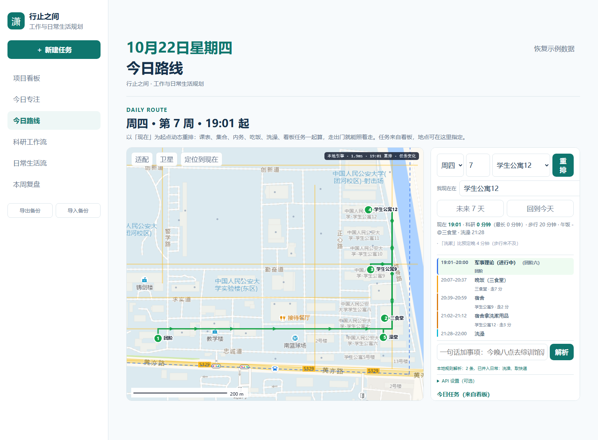

# 校园智能行程规划（行止之间 × 今日路线）

面向公安大学团河校区的**日常生活行进路线规划**：把课表、集合制度、内务门禁、
吃饭洗澡、看板任务一起算，从「此刻」出发给出"下一步该往哪走"，
并支持大模型解析自然语言、动态重排、跨天建议。

> 参赛用途：中国人民公安大学「AI+校园应用」优秀案例评比 · 申报方向：AI+学生成长



## 一、它解决什么

警校生的时间是**被制度切碎**的：三次集合（文化广场点名 5 分钟 → 带队走
正心路→求实路 → 铸剑楼/当日教室）、内务门禁、22:30 熄灯、周三下午中队活动。
真正能自由支配的只有缝隙，而缝隙里"先去哪、走哪条路、值不值得跑一趟"，
靠脑子算很容易失真——典型后果是：为了吃饭往返 30 分钟、洗澡错过内务检查、
晚上回宿舍泡面。

本项目把这件事变成**可计算**的：给一张带有 54 个点位与路网的地图，
用 Dijkstra 算真实步行时间，再用约束+评分模型排出一天。

## 二、核心能力

| 能力 | 说明 |
|---|---|
| 校园路网与 POI | 高德 WMS 瓦片拼接成 1px≈0.92m 的底图；54 个点位、14 条道路；点对点最短路 |
| 约束建模 | 三次集合、点名 5 分钟、带队路线、内务门禁、熄灯后可选自习、周三中队占用 |
| 个人规则 | 洗澡 32 分钟、晚饭只在 17:30–18:15 或不吃、宿舍 12 号楼、自习点偏好 |
| 动态重排 | 以「现在 + 我所在位置」为起点重算，1–5 ms；跨天自动切回今天 |
| 任务填充 | 看板任务（含延期任务，可开关）优先塞进空档，塞不下就给出「换哪天」建议 |
| 大模型接入 | 一句话 → 多个原子任务（地点/时长/窗口），再交给确定性引擎重排；密钥不出本机 |
| 跨天 | 「未来 7 天」对比每天的科研总量/最长整块/冲突数 |

## 三、目录结构

```
app/                 可直接在浏览器打开的应用（纯静态，无构建）
  index.html         入口
  app.js             行止之间原有工作台（看板/专注/复盘）
  route/             路线模块：data / core / schedule / planner / runtime / llm / view
  *.css
pipeline/            地图与路网的生成脚本（Python，零第三方依赖）
  tilemap.py         瓦片拼接
  annotate.py        点位标注（读 campus_data.json）
  build_graph.py     路网建图（线段求交 + 点位投影）
  merge_pois.py      点位合并 → 标注 → 建图 → 刷新前端数据
  campus_data.json   54 个点位 + 14 条道路 + 边界
  campus_graph.json  生成的路网（127 节点 / 133 边，全连通）
docs/
  合并说明.md        设计与逐步演进记录（含每一步的实测数据）
  API接入说明.md     大模型接入方式与本地代理
media/               截图
```

## 四、快速开始

**方式 A：直接看（不需要任何服务）**

双击 `app/index.html`。此时大模型能力关闭，一句话解析走本地规则（也能拆句）。

**方式 B：带大模型（推荐）**

```powershell
cd app\route
python llm_proxy.py            # 零依赖本地代理，默认 4181 端口
# 然后浏览器打开 http://127.0.0.1:4181/
```

密钥放在**站点目录之外**（`<workspace>/.secrets/llm.env`），由代理读取，网页端拿不到。
详见 `docs/API接入说明.md`。

## 五、已知限制（欢迎一起补）

- 路网来自瓦片目视描点，个别路段可能画短了（历史上修过两处：正心路、警知路北端），
  未知路段建议用「地图上点两下」的方式补；
- 步行速度按 1.2 m/s（72 m/min）估算，含路口等待；个体差异需要可调；
- 洗澡候选时段目前是固定几个时刻（17:10/17:40/20:30/21:00），应改为相对时段；
- 大模型只负责"把话拆成任务"，不负责排程；排程始终是确定性算法（可复现、可解释）；
- 只排单日；跨天只做"对比建议"，没有做全局优化。

## 六、数据与隐私

- 校园底图来自高德公开瓦片（仅供学习研究，不得商用）；
- 课表、作息、个人规则来自作者本人，提交前已脱敏；
- 仓库**不含任何密钥**；`.gitignore` 已排除 `.secrets/` 与 `*.env`。

## 七、License

MIT
